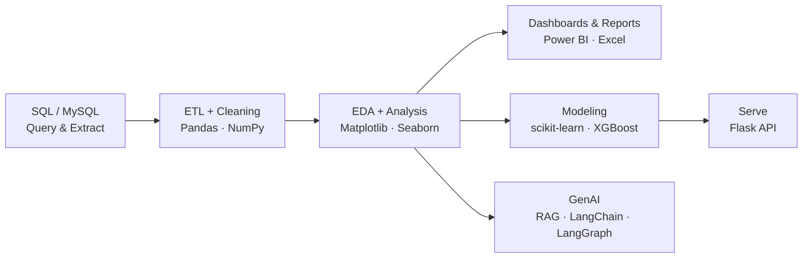

<div align="center">


<a href="https://git.io/typing-svg">
  
</a>
<br/><br/>
 


</div>

 
## About Me
 
```python
class Prajwal:
    name    = "Prajwal Ghotkar"
    roles   = ["Data Analyst", "SQL Developer", "ML Engineer"]
    stack   = ["Python", "SQL", "Pandas", "scikit-learn", "XGBoost", "LangChain", "LangGraph"]
    exploring = ["RAG", "Agentic AI", "LLMs", "Model Deployment with Flask"]
    fun_fact  = "The world is one big data problem"
 
    def mission(self):
        return "Turn messy data into clear insights and intelligent decisions."
 
print(Prajwal().mission())
```
 
<table>
<tr>
<td width="50%">
### Currently
- Analysing data with **SQL, Python & Excel** to answer business questions
- Building **dashboards & reports** that track KPIs
- Training and evaluating **ML models** end to end
- Exploring **RAG** and **Agentic AI** with LangChain and LangGraph
</td>
<td width="50%">
### Goals
- Work as a **Data Analyst / SQL Developer / ML Engineer**
- Deliver **insights that drive business decisions**
- Ship **production-ready ML pipelines**
- Tell stories with data
</td>
</tr>
</table>
 
## Skills
 
### Data Analysis & Reporting
`Data Cleaning` · `Data Wrangling` · `Exploratory Data Analysis (EDA)` · `Statistical Analysis` · `KPI Tracking` · `Data Visualization` · `Dashboarding` · `Business Analysis` · `A/B Testing` · `Hypothesis Testing` · `ETL Pipelines`
 


### SQL & Databases
`SELECT` · `Joins` · `Subqueries` · `CTEs` · `Window Functions` · `Aggregations` · `Indexing & Query Optimization` · `Stored Procedures` · `Views` · `Data Modeling`
 


### Programming & Libraries


### Machine Learning
`Supervised & Unsupervised Learning` · `Regression` · `Classification` · `Clustering` · `Linear Regression` · `Logistic Regression` · `Decision Trees` · `Random Forest` · `XGBoost` · `SVM` · `KNN` · `K-Means` · `Feature Engineering` · `Model Evaluation` · `Hyperparameter Tuning` · `Predictive Analytics`
 
### Generative AI & LLMs


### Tools


 
## My Workflow
 

 
 
## Featured Projects
 
> Replace these with your real repositories and add links.
 
| Project | Role | Description | Tech |
|---|---|---|---|
| **Sales / Business Dashboard** | Data Analyst | KPI dashboard with trends, segments and actionable insights | `Power BI` `Excel` `SQL` |
| **EDA & Business Insights** | Data Analyst | Cleaning, exploration and storytelling on a real-world dataset | `Pandas` `Seaborn` `Matplotlib` |
| **A/B Testing & Hypothesis Testing** | Data Analyst | Statistical tests to validate business decisions | `Python` `SciPy` `Pandas` |
| **SQL Analytics Project** | SQL Developer | Complex joins, CTEs and window functions for business reporting | `MySQL` `SQL` |
| **ML Prediction Pipeline** | ML Engineer | End to end: cleaning, features, training, evaluation | `Python` `scikit-learn` `XGBoost` |
| **ML Model API** | ML Engineer | Trained model served as a REST API | `Flask` `Python` |
| **RAG Chatbot** | GenAI | Ask questions over your own documents with retrieval + LLM | `LangChain` `RAG` `LLMs` |
| **Agentic AI Workflow** | GenAI | Multi-step AI agent with tools and state | `LangGraph` `LangChain` |
 
 
## GitHub Stats
 
<div align="center">


<br/>

<br/>

</div>

 
## Let's Connect
 
<div align="center">
<a href="mailto:pmghotkar05@gmail.com"></a>
<a href="https://linkedin.com/in/prajwal-ghotkar-9618272a5"></a>
<a href="https://www.instagram.com/prajwalghotkar_02/"></a>
<a href="https://github.com/prajwalghotkar"></a>
 
<br/><br/>
 

</div>

 
